# Adaboost

**AdaBoost** (short for **Adaptive Boosting**) is a popular Ensemble Learning algorithm that combines multiple weak models to create one highly accurate strong model.

Imagine a group of students preparing for an exam. Student 1 takes a practice test and gets a few questions wrong. Student 2 focuses specifically on studying the questions Student 1 got wrong. Student 3 then focuses on the questions both Student 1 and Student 2 missed. When they take the final exam together, their combined focus covers all weak spots. That is how AdaBoost works.

---

### Core Concept Anatomy: Step-by-Step

1. **Weak Learners (Decision Stumps):**
* AdaBoost typically uses single-split Decision Trees called **Decision Stumps** (trees with a depth of 1) as base models. A single stump is barely better than random guessing.


2. **Assigning Sample Weights:**
* Initially, every data point starts with equal weight ($\frac{1}{N}$).


3. **Sequential Training & Re-weighting:**
* A stump is trained on the data.
* Samples that the stump **misclassifies are given higher weights**, while correctly classified samples get lower weights.
* The next stump focuses heavily on the newly emphasized misclassified points.


4. **Amount of Say (Voting Power):**
* Stumps with lower error rates get a higher **Amount of Say** (higher voting weight) in the final prediction, while high-error stumps get very little say.


5. **Final Aggregation:**
* Predictions from all stumps are combined using a weighted majority vote (for classification) or weighted sum (for regression).


---

### AdaBoost vs. Other Ensemble Methods

| Algorithm | Core Idea | Base Learner Type | Sequential or Parallel? | Handling of Errors |
| --- | --- | --- | --- | --- |
| **AdaBoost** | Increases weights of misclassified samples in iterations | Weak learners (e.g., Decision Stumps) | **Sequential** | Focuses explicitly on misclassified points |
| **Random Forest** | Builds independent trees on random subsamples (Bagging) | Deep, fully grown Decision Trees | **Parallel** | Reduces variance by averaging tree votes |
| **Gradient Boosting** | Fits new trees to the **residuals** (errors) of previous trees | Shallow Decision Trees | **Sequential** | Minimizes a loss function using gradient descent |

---

### Practical Use Cases & Trade-offs

* **Best Used For:** Binary classification tasks, customer churn prediction, fraud detection, and face detection (e.g., Viola-Jones algorithm).
* **Key Limitations:** Sensitive to **noisy data and outliers** because it keeps increasing the weight of misclassified noisy points, which can lead to overfitting on noise.

---

### Common Interview Scenarios

#### Scenario 1: Why is AdaBoost vulnerable to noisy data and outliers?

**Answer:** AdaBoost exponentially increases the sample weight of data points that are misclassified at each step. If a dataset has outliers or noisy labels, AdaBoost repeatedly fails to classify them correctly and focuses heavily on fitting those single outlier points, corrupting the overall decision boundary and leading to overfitting.

#### Scenario 2: How does AdaBoost differ from Gradient Boosting (GBM)?

**Answer:** While both build models sequentially, **AdaBoost adjusts sample weights** after each iteration to focus on missed points, whereas **Gradient Boosting fits new models directly to the pseudo-residuals** (the negative gradients of the loss function) of the previous models.

## [AdaBoost, Clearly Explained](https://youtu.be/LsK-xG1cLYA?si=OxcGSX2q0Ke_zzV8)

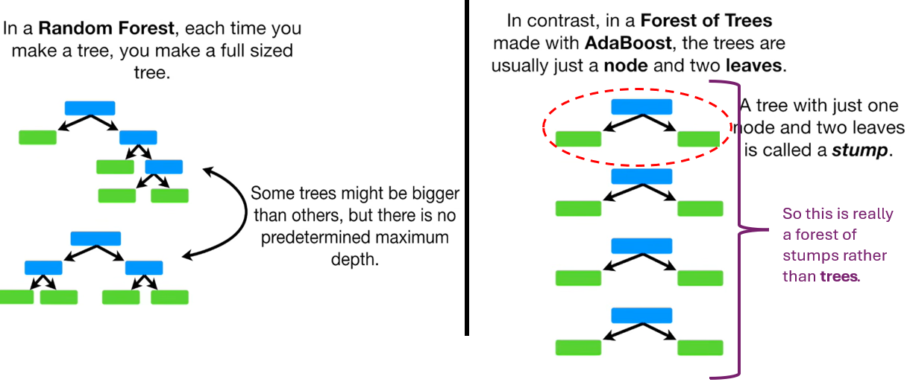

**Stumps** are not good at making accurate classifications.

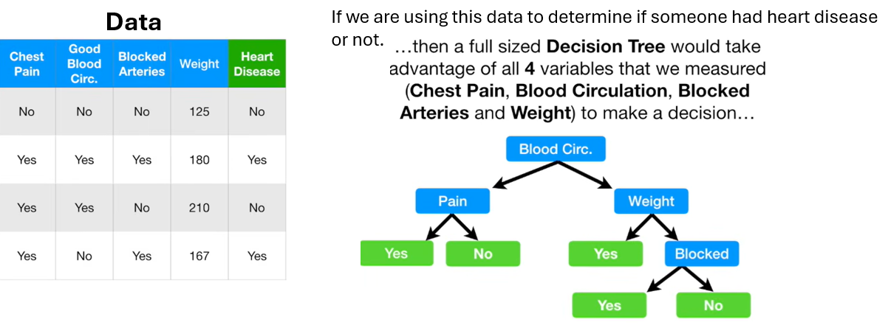

But a stump can only use one variable to make a decision.

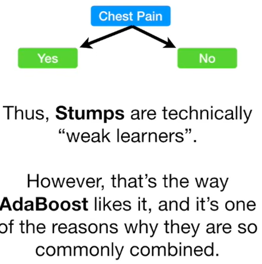

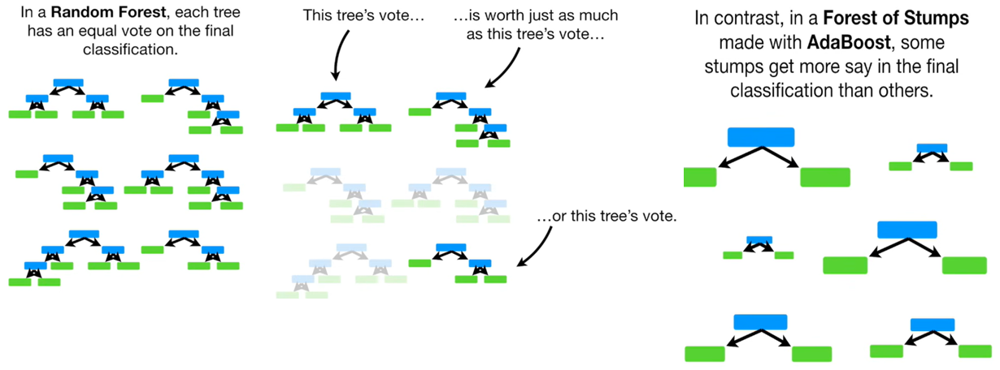

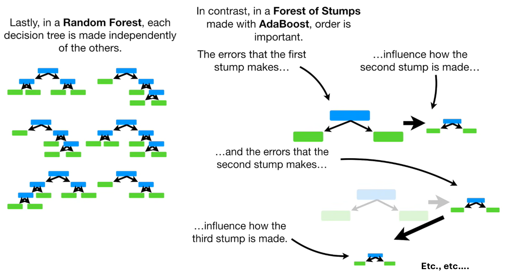

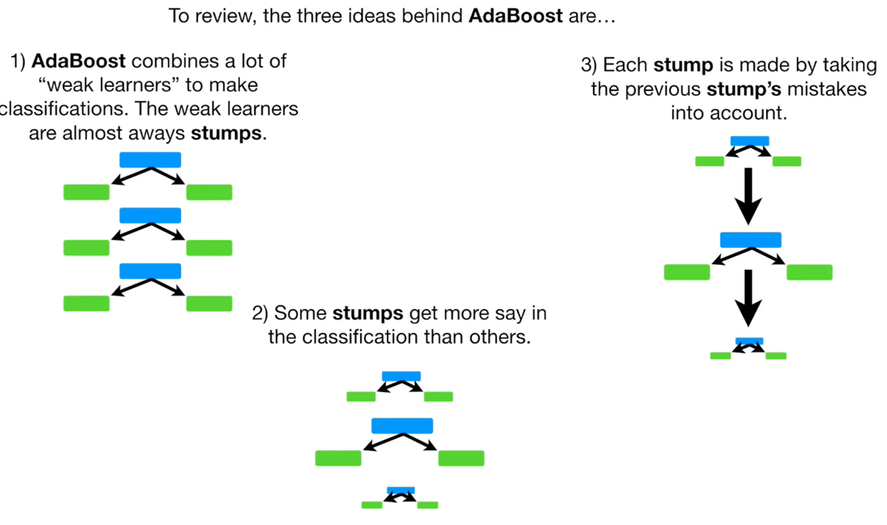

### Creating Forest of Stumps using Adaboost

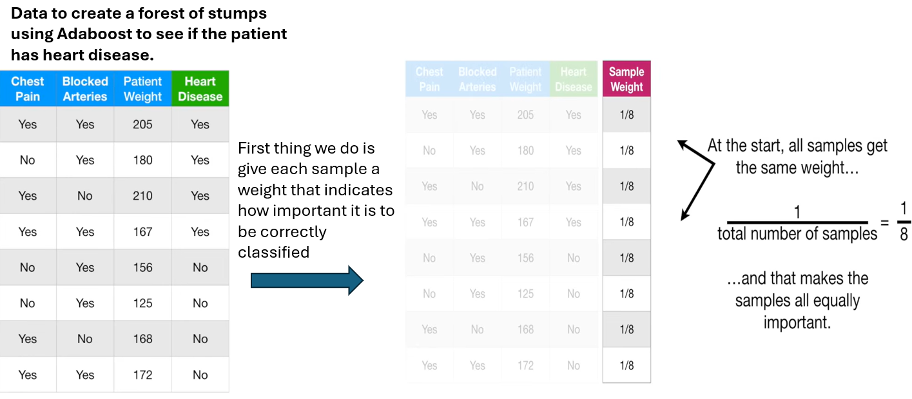

After we make the 1st stump, these weights will change in order to guide how the next stump is created.

This will be done by finding the variable - **Chest Pain**, **Blocked Arteris** or **Patient Weight** that does the best job in classifying the samples.

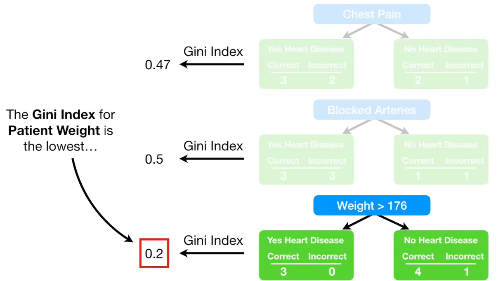

The Gini Index for the **Patient Weight** is lowest(Check the Decision Tree Notes - to see how the Gini Index was computed for this dataset). So it will be the 1st stump in the forest. Now we need to determine how much say this stump will have in the final classification.

> We determine how much say a stump has in the final classification based on how well it classified the samples.

Look at Column: **Weight**

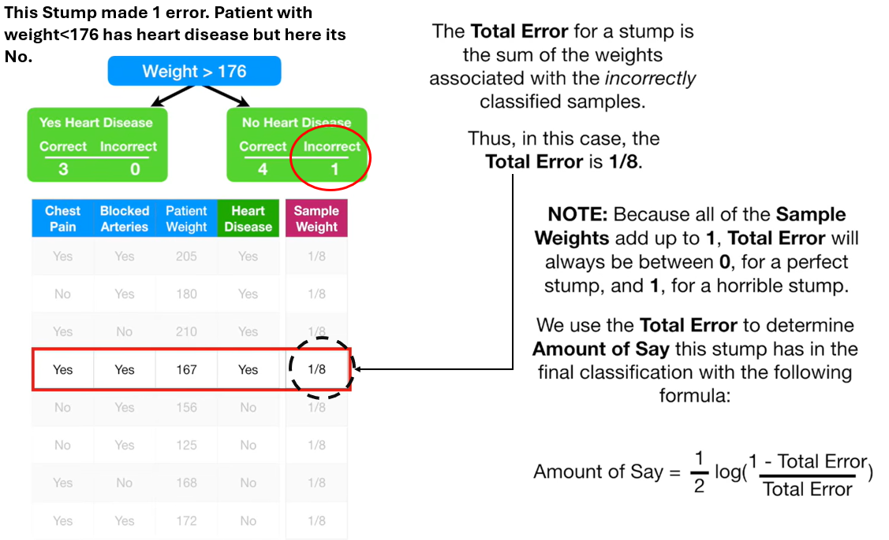

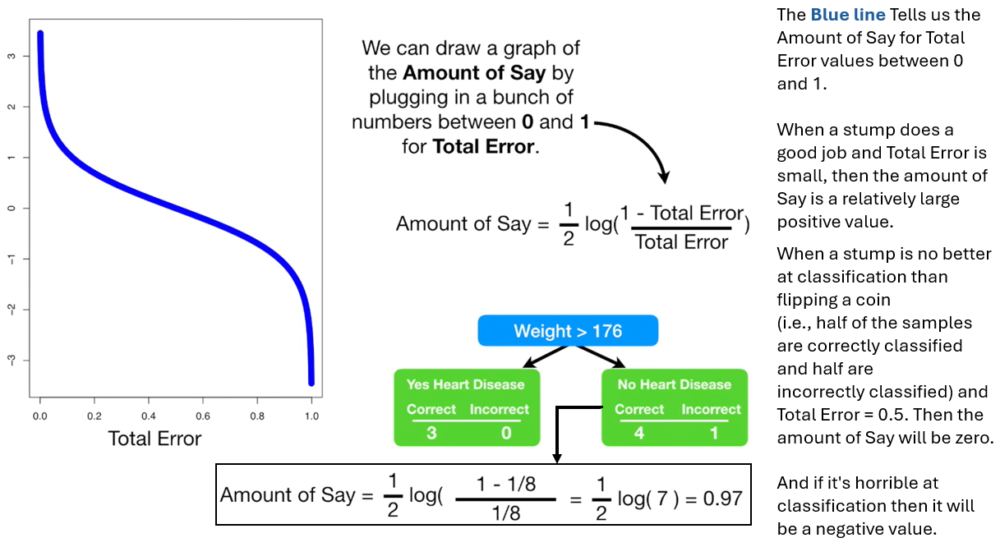

Look at Column: **Chest Pain**

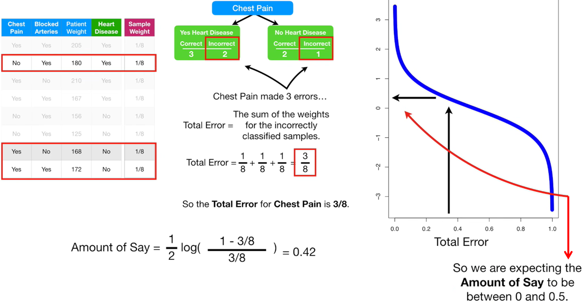


Similarly, Say can be computed for Column - **Blocked Arteries**.

Now we need to learn how to modify the weights so that the next stump will take the errors that the current stomp made into account.

### Updating Sample Weights

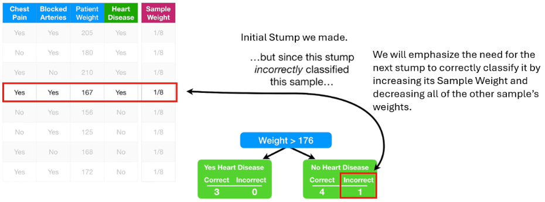

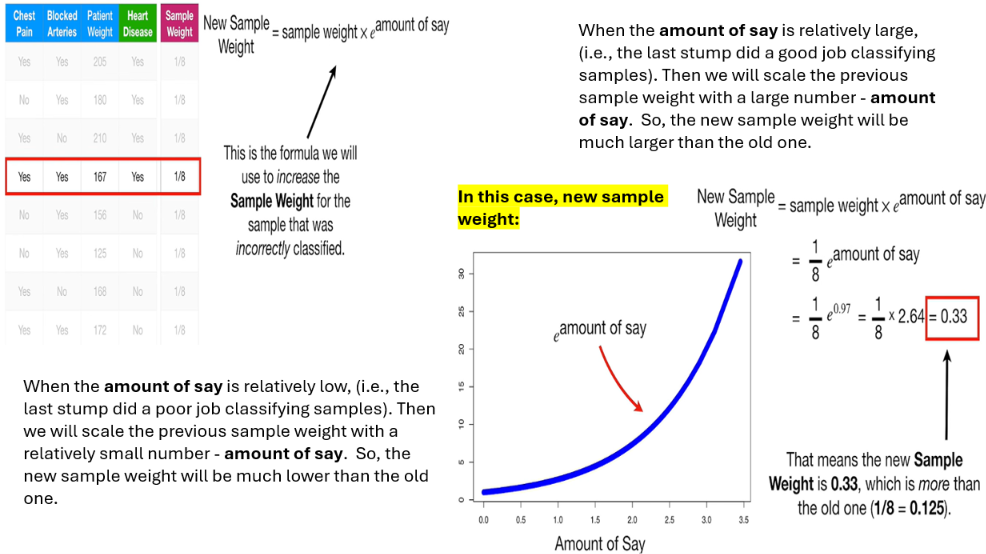

> **Correction to the image above:** When the amount of say is relatively low, the new sample weight will be **slightly higher** than the old one, not "much lower". This formula is for misclassified samples, and $e^{\text{amount of say}} \geq 1$ for any non-negative amount of say. Also, the previous sample weight is scaled by $e^{\text{amount of say}}$, not by the amount of say itself.

Now we need to decrease the sample weights for all of the correctly classified samples.

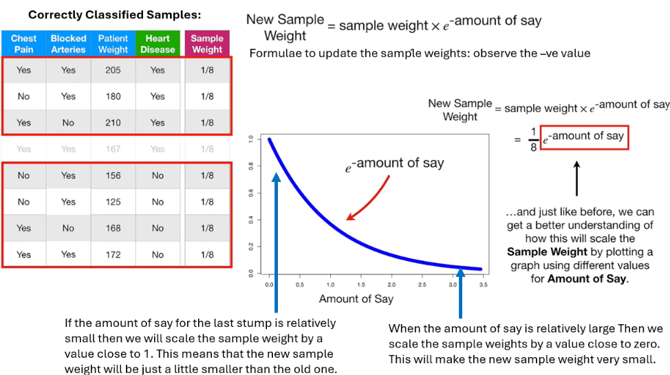

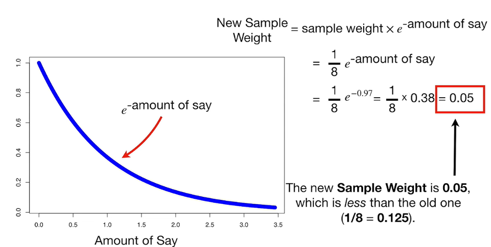

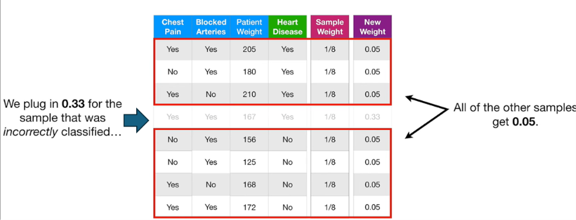

Now we need to normalize the New Sample Weights so that they will add up to 1. 

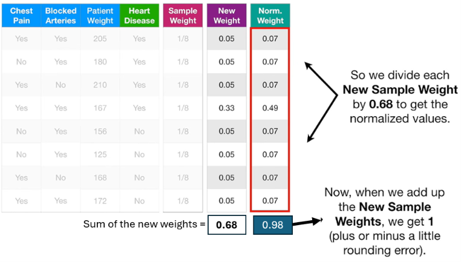

### Using the Normalized Weights to make the 2nd stump

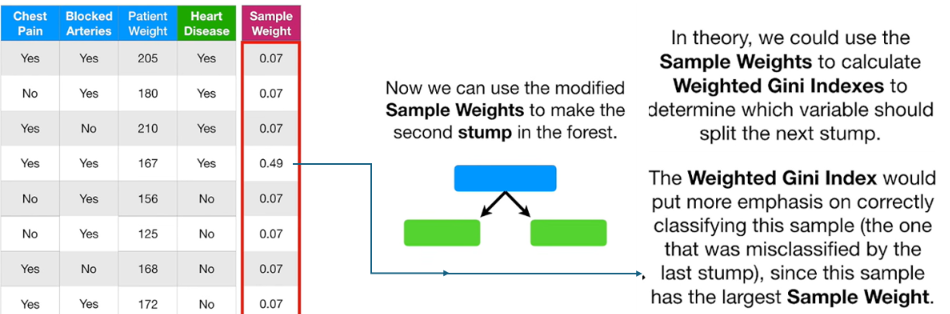

> **Note on "In theory" in the image above:** The Weighted Gini Index is one of two approaches. If an implementation can't use sample weights, we draw a new dataset of the same size with replacement, where each sample's selection probability equals its weight. The 167 patient then appears about half the time, and a normal Gini Index works. scikit-learn's trees accept weights directly, so they use the weighted Gini calculation shown below.

**The 2nd stump is `Patient Weight > 161.5`**, with the lowest Weighted Gini Index of 0.238. It uses the same variable as stump 1 but a different threshold, moved to catch the 167 patient that stump 1 got wrong.

A normal Gini Index counts each patient as 1. A Weighted Gini Index counts each patient by their sample weight, so the 167 patient (0.49) counts as much as seven other patients (0.07 each). The tree is therefore pushed to get that patient right.

#### Step 1: Start with the normalized weights

| # | Chest Pain | Blocked Arteries | Patient Weight | Heart Disease | Norm. Weight |
| --- | --- | --- | --- | --- | --- |
| 1 | Yes | Yes | 205 | Yes | 0.07 |
| 2 | No | Yes | 180 | Yes | 0.07 |
| 3 | Yes | No | 210 | Yes | 0.07 |
| **4** | **Yes** | **Yes** | **167** | **Yes** | **0.49** ← stump 1's mistake |
| 5 | No | Yes | 156 | No | 0.07 |
| 6 | No | Yes | 125 | No | 0.07 |
| 7 | Yes | No | 168 | No | 0.07 |
| 8 | Yes | Yes | 172 | No | 0.07 |
| | | | | **Total** | **0.98** (rounding, really 1) |

#### Step 2: Weighted Gini formula

Replace every count with a **sum of weights**:

$$
\text{Gini}_{\text{leaf}} = 1 - p_{\text{yes}}^2 - p_{\text{no}}^2,
\qquad
p_{\text{yes}} = \frac{\text{weight of Yes samples in leaf}}{\text{total weight in leaf}}
$$

$$
\text{Weighted Gini}_{\text{split}} = \frac{W_L}{W}\,\text{Gini}_L + \frac{W_R}{W}\,\text{Gini}_R
$$

* $W_L$ and $W_R$ are the total sample weights in the left and right leaves.
* $W$ is the total weight of all samples, here 0.98.

#### Step 3: Try each candidate split

**Chest Pain**

```
                  Chest Pain?
               Yes /       \ No
                  /         \
   Disease Yes: 0.63       Disease Yes: 0.07
   Disease No : 0.14       Disease No : 0.14
   Total      : 0.77       Total      : 0.21
   Gini       : 0.298      Gini       : 0.444
```

$$\frac{0.77}{0.98}(0.298) + \frac{0.21}{0.98}(0.444) = \mathbf{0.329}$$

**Blocked Arteries**

```
               Blocked Arteries?
               Yes /       \ No
                  /         \
   Disease Yes: 0.63       Disease Yes: 0.07
   Disease No : 0.21       Disease No : 0.07
   Total      : 0.84       Total      : 0.14
   Gini       : 0.375      Gini       : 0.500
```

$$\frac{0.84}{0.98}(0.375) + \frac{0.14}{0.98}(0.500) = \mathbf{0.393}$$

**Patient Weight > 161.5 (the winner)**

```
              Patient Weight > 161.5?
               Yes /       \ No
                  /         \
   Disease Yes: 0.70       Disease Yes: 0.00
   (205,180,210,167)
   Disease No : 0.14       Disease No : 0.14
   (168,172)               (156,125)
   Total      : 0.84       Total      : 0.14
   Gini       : 0.278      Gini       : 0  (pure)
```

The left-leaf Gini is $1 - (0.70/0.84)^2 - (0.14/0.84)^2 = 0.278$, so:

$$\frac{0.84}{0.98}(0.278) + \frac{0.14}{0.98}(0) = \mathbf{0.238}$$

**All candidates ranked**

| Rank | Split | Weighted Gini |
| --- | --- | --- |
| **1** | **Patient Weight > 161.5** | **0.238** |
| 2 | Chest Pain | 0.329 |
| 3 | Patient Weight > 140.5 | 0.330 |
| 4 | Patient Weight > 176 (stump 1) | 0.364 |
| 5 | Patient Weight > 192.5 | 0.381 |
| 6 | Blocked Arteries | 0.393 |
| 7 | Patient Weight > 167.5 | 0.394 |
| 8 | Patient Weight > 207.5 | 0.396 |
| 9 | Patient Weight > 170 | 0.407 |

#### Step 4: What changed between stumps

```
Stump 1 (equal weights)              Stump 2 (updated weights)

     Weight > 176                         Weight > 161.5
      /        \                           /          \
   Yes          No                      Yes            No
 3 right     4 right, 1 wrong        4 right        2 right
              (the 167 patient)      2 wrong
                                     (168, 172)
```

| | Stump 1 | Stump 2 |
| --- | --- | --- |
| Is the 167 patient correct? | No | **Yes** |
| Mistakes | 1 patient | 2 patients |
| Total Error | 1/8 = 0.125 | 1/7 ≈ 0.14 |
| Amount of Say | 0.97 | ½ ln(6) ≈ 0.90 |

Stump 2 makes more mistakes by count, but they are cheap ones. It accepts two 0.07 errors to avoid one 0.49 error.

Stump 2's Total Error and Amount of Say then feed the same update as before. The 168 and 172 patients gain weight, and stump 3 focuses on them.

#### Why stump 1's split lost

With the exact values, the normalized weights are 0.5 for the 167 patient and 1/14 ≈ 0.0714 for each of the others. The 0.49 and 0.07 are the rounded versions, and they give the same Gini values because their ratio is the same (7:1).

This 50% isn't a coincidence. After normalizing, the misclassified samples **always** hold exactly half the total weight. Stump 1 now has an error of 0.5 on the new weights, which is no better than a coin flip, so a useful next stump has to split differently.


### Using Stump's to make classification

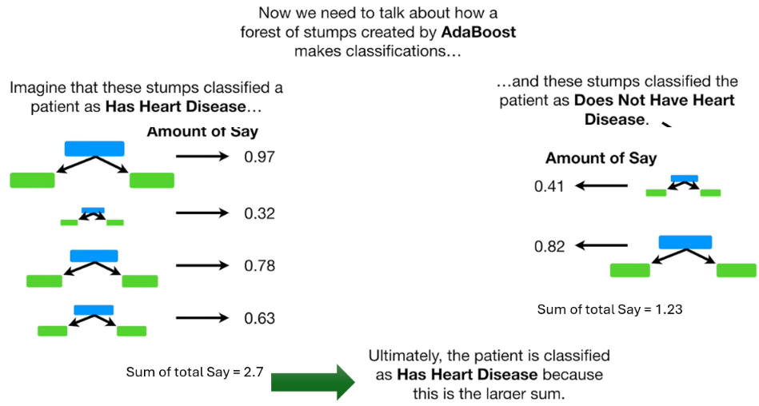

### Summary


