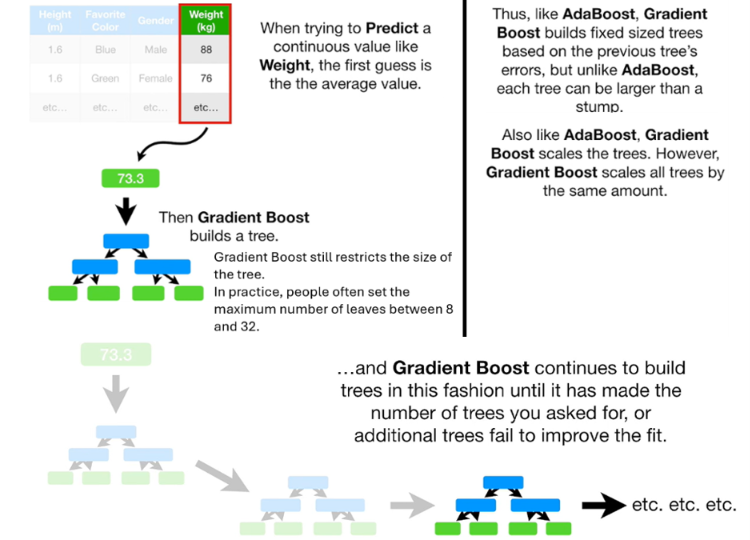
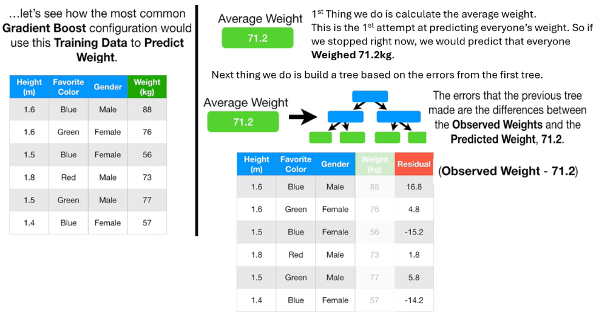
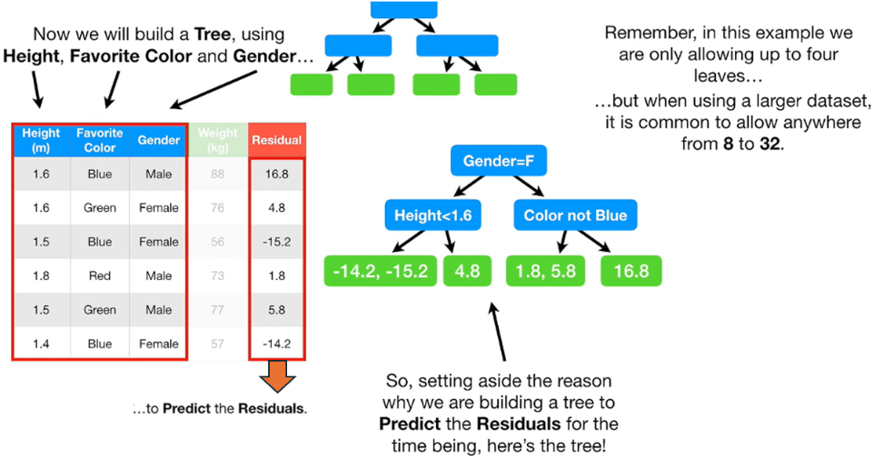
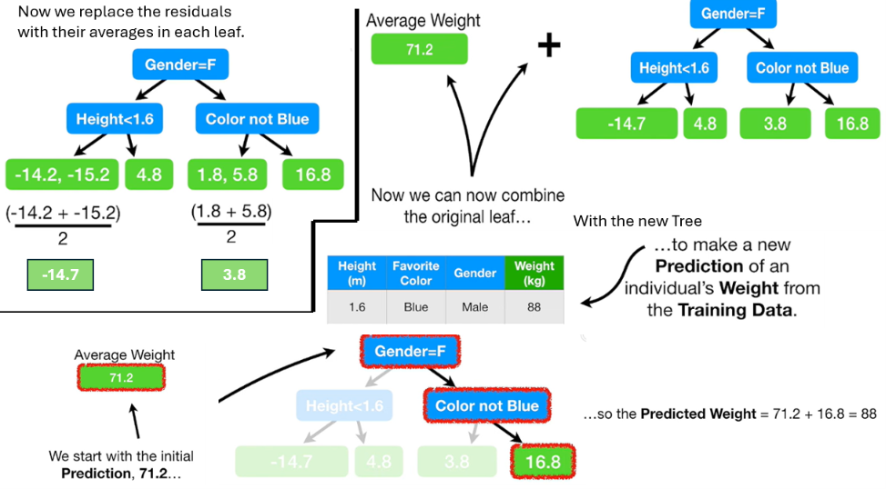
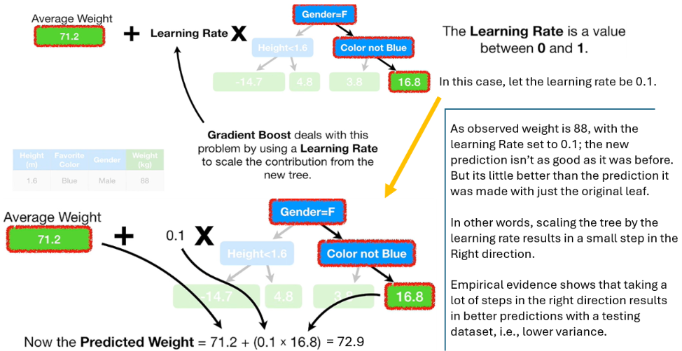
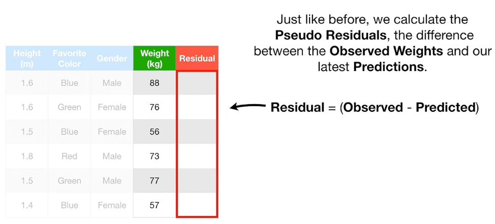
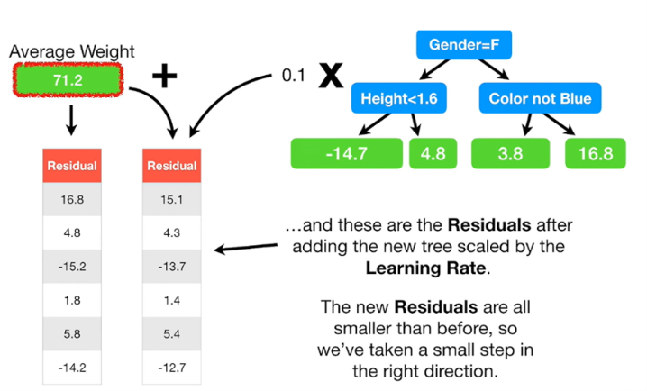
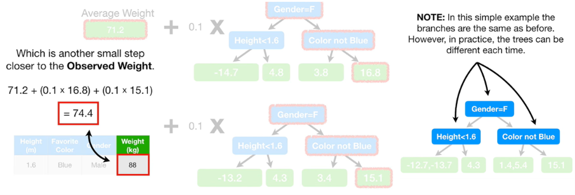
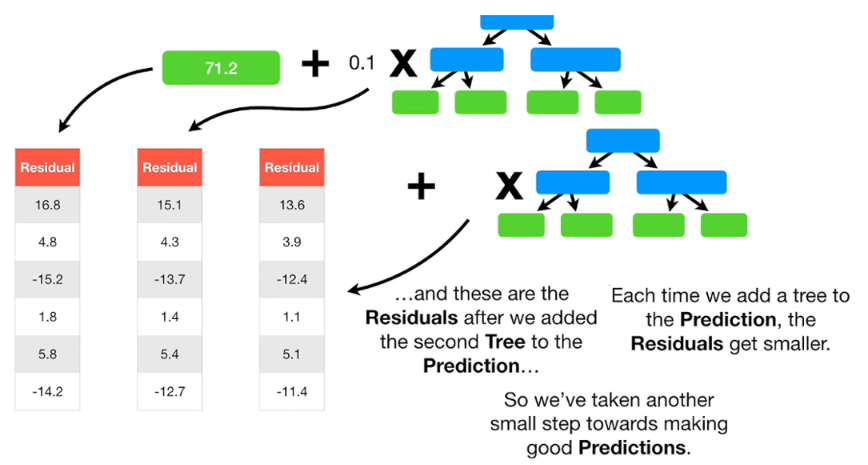

# Gradient Boosting
## [Gradient Boost Part 1 (of 4): Regression Main Ideas](https://youtu.be/3CC4N4z3GJc?si=U2zkrKcYLGD_nxFt)

**NOTE:** The **Gradient Boost** algorithm looks complicated because it was designed to be configured in a wide variety of ways but the reality is that 99% of the time only one configuration is used to predict continuous values and one configuration is used to *Classify* samples into different categories.

Gradient Boost starts by making an initial leaf instead of a tree or a stump. This leaf represents an initial guess for the weights of all of the samples. 

The Weight hence predicted is same as the observed weight (88kg). This is not good as the model fits the data too well i.e., we have low bias and high variance.  

And we keep making trees until we reach the maximum specified, or adding additional trees does not significantly reduce the size of the **Residuals**.
