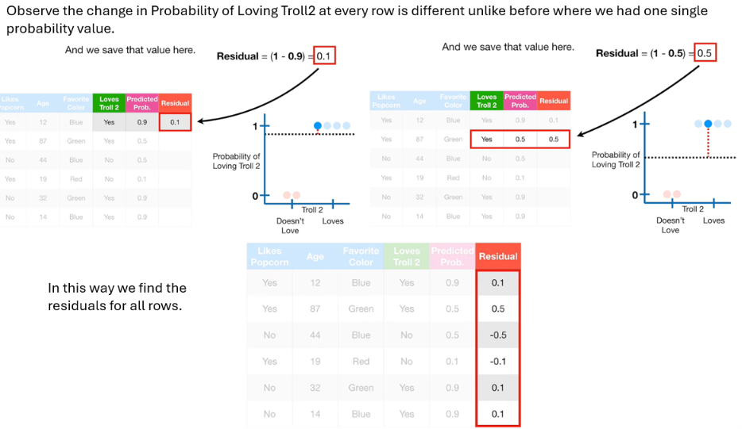
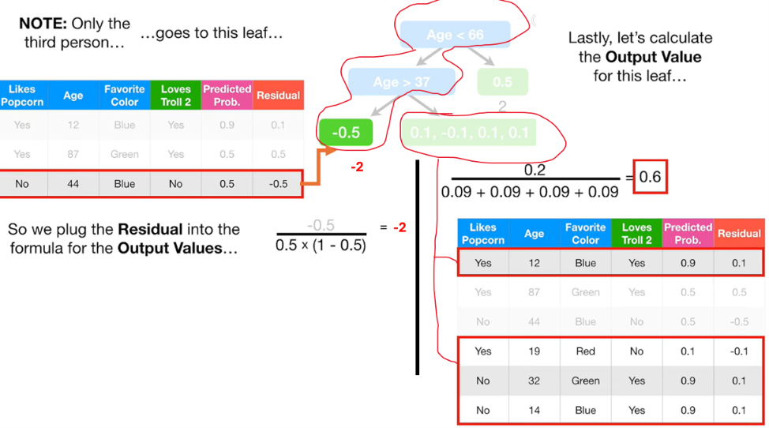
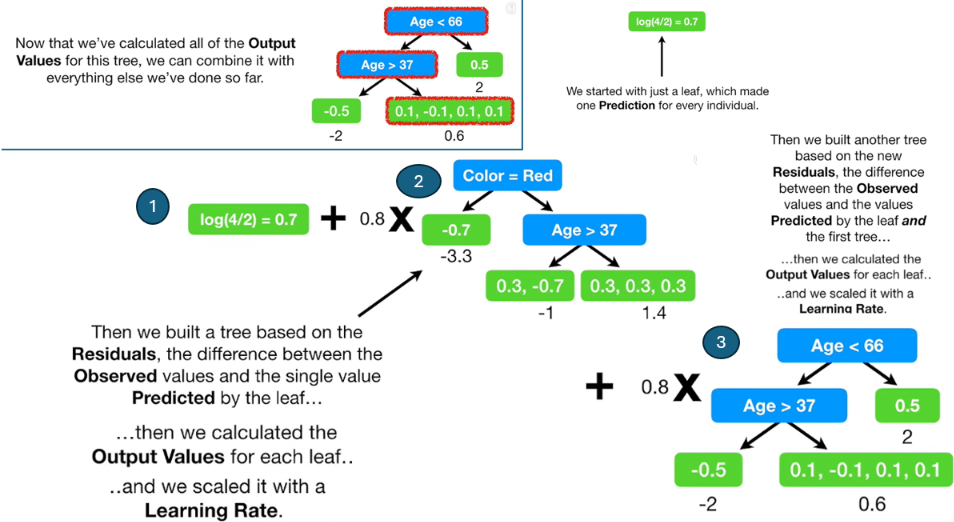
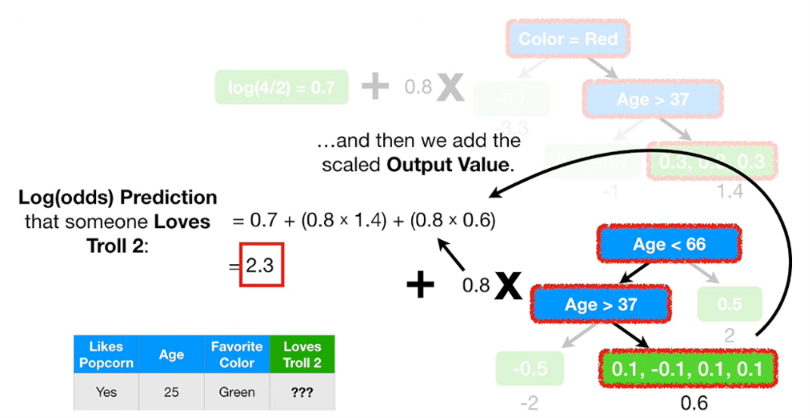

# [Gradient Boost: Classification](https://youtu.be/jxuNLH5dXCs?si=EA3MoAgAtfh8wqDE)

This training data where we have collected popcorn preference from six people their age, their favorite color and whether or not they loved the movie troll two.

And now, just like before, we calculate the new Residuals and just like before, Residuals are the difference between the Observed and Predicted Probabilities.  
And just like before, we can plot the Observed Probabilities on a graph however, now everyone has a different Predicted Probability.

Now that we have the residuals, we can build a new tree and then we need to calculate the Output values for each leaf.

Lets start with this leaf:

This process repeats until we have reached the maximum number of trees specified or the residuals get super small. 

Now, for the sake of keeping the example relatively simple, imagine that we configured **Gradient Boost** to just make these two trees and we needed to **Classify** a new person as someone who **Loves Troll 2** or *does **not** * **Love Troll 2**.

Now we need to convert this **Log(odds)** into a **Probability**.

So we plug the **Log(odds)** into the **Logistic Function**.

$$\text{Probability} = \frac{e^{\text{log(odds)}}}{1 + e^{\text{log(odds)}}}$$

$$\text{Probability} = \frac{e^{2.3}}{1 + e^{2.3}} = 0.9$$

And the **Predicted Probability** that this individual will **Love Troll 2** is **0.9**.

Since we are using **0.5** as our threshold for deciding how to **Classify** people, and $\mathbf{0.9 > 0.5}$ we will **Classify** this person as someone who **Loves Troll 2**.

Gradient Boost usually uses tree between 8 to 32 leaves.

