# Bias and Variance

**Bias** is the error from a model's overly simple assumptions, causing it to underfit the data.  
**Variance** is the error from a model's high sensitivity to small changes and noise in the training set, causing it to overfit.  
The [Bias-Variance Tradeoff](https://www.ibm.com/think/topics/bias-variance-tradeoff) requires balancing these two errors to minimize total prediction error on unseen data. [1, 2] 
## Core Definitions

* Bias: The distance between the model's average prediction and the true value. High bias means the model ignores relevant patterns (e.g., fitting a straight line to curved data).
* Variance: The amount the model's predictions change if trained on a different subset of data. High variance means the model captures random noise instead of real trends. [1, 3, 4, 5, 6, 7] 

------------------------------
## Comparison Table

| Feature | High Bias (Underfitting) | High Variance (Overfitting) | Optimal Model |
|---|---|---|---|
| Model Complexity | Too low (e.g., linear regression) | Too high (e.g., deep decision tree) | Balanced |
| Training Error | High | Low | Low |
| Test Error | High | High | Low |
| Generalization | Poor | Poor | Good |

------------------------------
## How to Fix Them
### Reducing High Bias

* Increase model complexity (e.g., use polynomial features or deeper networks).
* Add more relevant input features or drop heavy regularization.
* Train for a longer duration or switch to a more flexible algorithm. [3, 8, 9] 

### Reducing High Variance

* Add more training data so the model stops memorizing noise.
* Apply regularization (such as L1/Lasso or L2/Ridge) to penalize large weights.
* Use ensemble methods like bagging (Random Forests) or boosting to average out predictions.
* Perform feature selection to remove noisy or redundant inputs. [1, 7, 8, 9, 10] 

[1] [https://www.ibm.com](https://www.ibm.com/think/topics/bias-variance-tradeoff)  
[2] [https://mlu-explain.github.io](https://mlu-explain.github.io/bias-variance/)  
[3] [https://www.geeksforgeeks.org](https://www.geeksforgeeks.org/machine-learning/bias-vs-variance-in-machine-learning/)  
[4] [https://www.youtube.com](https://www.youtube.com/watch?v=tUs0fFo7ki8)  
[5] [https://www.youtube.com](https://www.youtube.com/watch?v=EuBBz3bI-aA)  
[6] [https://www.scribd.com](https://www.scribd.com/document/591085883/Bias-and-Variance-in-Machine-Learning)  
[7] [https://www.bmc.com](https://www.bmc.com/blogs/bias-variance-machine-learning/)  
[8] [https://www.youtube.com](https://www.youtube.com/watch?v=nbY2KqXSsaE)  
[9] [https://en.wikipedia.org](https://en.wikipedia.org/wiki/Bias%E2%80%93variance_tradeoff)  
[10] [https://uniathena.com](https://uniathena.com/understanding-bias-variance-tradeoff-balance-model-performance)  

## [Bias, Variance and Overfitting](https://youtu.be/EuBBz3bI-aA?si=ROK0VCnY-aIZDZjT)
This video from *StatQuest with Josh Starmer* explains the fundamental machine learning concepts of **bias and variance** using a relatable example involving predicting mouse height based on weight.

### Key Concepts:

*   **Splitting Data (1:23):** The process begins by dividing data into a **training set** (to build the model) and a **testing set** (to evaluate performance).
*   **Bias (2:16):** This represents the error from erroneous assumptions in the learning algorithm.
    *   **Linear Regression:** Fits a straight line, which is too simple to capture the true, curved relationship, resulting in **high bias (2:25).**
*   **Variance (4:06):** This refers to the model's sensitivity to fluctuations in the training set.
    *   **Squiggly Line:** A highly flexible model that fits the training data perfectly but fails to generalize well to new data, leading to **high variance (4:24).** This is also known as **overfitting (5:10).**
*   **The Sweet Spot (5:23):** The goal of machine learning is to find a model that balances bias and variance to ensure both accuracy and consistency across different datasets. Methods like **regularization, boosting, and bagging (5:49)** are commonly used to achieve this.

# Decision Trees

## [Decision and Classification Trees - Part 1](https://youtu.be/_L39rN6gz7Y?si=EaMgeb2bL_RJxW9E)

This video from *StatQuest with Josh Starmer* provides a clear explanation of how **decision trees** and **classification trees** work. It covers the fundamental concepts, the process of building a tree from scratch, and techniques to improve model performance.

### Key Concepts of Decision Trees (0:18 - 3:11)

*   **Classification Trees:** Used to categorize data into classes (e.g., Yes/No).
*   **Regression Trees:** Used to predict numeric values (e.g., size).
*   **Anatomy of a Tree:**
    *   **Root Node:** The starting point at the top.
    *   **Internal Nodes (Branches):** Intermediate points that ask a question about the data.
    *   **Leaf Nodes (Leaves):** Final output points where no further splitting occurs.

### Building a Tree (3:16 - 15:37)

Josh demonstrates how to build a tree to predict if someone will love the movie *Cool as Ice* based on their preferences for popcorn, soda, and their age:

1.  **Quantifying Impurity:** He explains **Gini Impurity** as a metric to measure how mixed the data is within a node. The goal is to choose splits that minimize this impurity.
2.  **Numeric Variables:** For continuous data like age, the process involves sorting the data and testing various split thresholds (e.g., *age \< 9.5*) to find the point that results in the lowest Gini impurity.
3.  **Iterative Splitting:** The tree is built by repeatedly splitting nodes until the data is categorized into clean (pure) or manageable leaves.
4.  **Final Classification:** Output values are assigned based on the majority category found in each leaf.

### Advanced Considerations (15:38 - 17:43)

*   **Preventing Overfitting:** Since complex trees can capture noise in the data, the video suggests:
    *   **Pruning:** Removing unnecessary branches.
    *   **Growth Limits:** Setting constraints, such as requiring a minimum number of samples per leaf.
    *   **Cross-Validation:** Using this technique to test different parameters and select the model that generalizes best to new data.

---

## [Regression Trees](https://youtu.be/g9c66TUylZ4?si=ASxSPnKTjzVJog5v)

This *StatQuest* video explains how **Regression Trees** are constructed and why they are useful when data relationships aren't linear. Unlike **Classification Trees**, which predict categories, **Regression Trees** use leaves to represent specific **numeric values** (2:19-2:35).

**Key concepts covered include:**

*   **Motivation:** Regression trees are ideal when simple linear regression fails to accurately capture data trends, such as drug effectiveness across varying dosages (0:41-2:19).
*   **Building a Tree:** The process begins by selecting a threshold that minimizes the **Sum of Squared Residuals (SSR)**. The tree grows from the top down by testing thresholds across predictors (7:11-12:58). The predicted values here are the average of all y-values in that class (i.e., from figure i.e.: `Dosage > 3`) 
    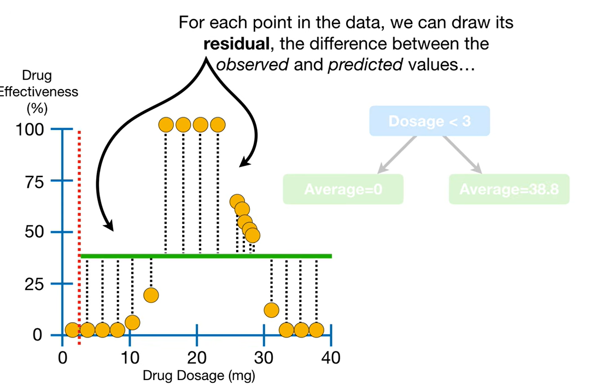

    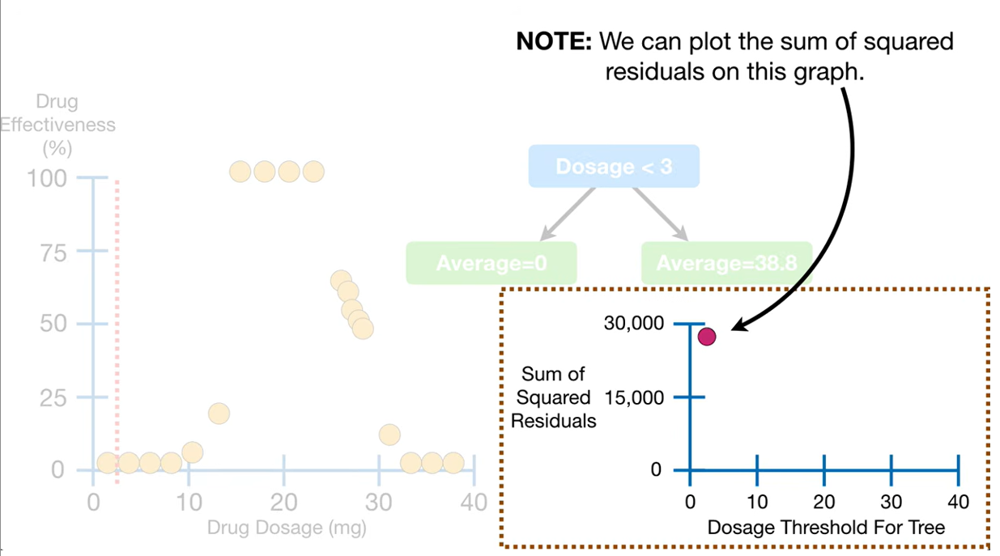

    Compute the sum of residuals across all threshold. Choose the smallest sum of residuals.
    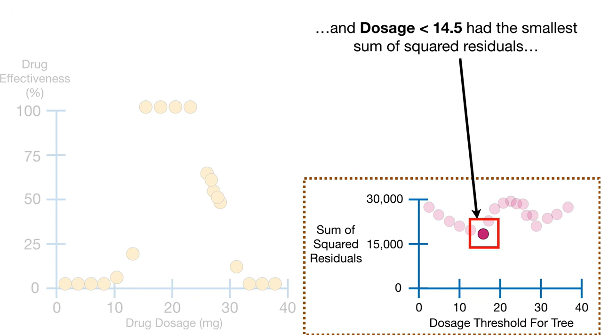

*   **Multiple Predictors:** When using multiple variables (like dosage, age, and sex), the model compares the lowest SSR for each candidate variable to determine the root and subsequent branches (18:59-20:54).
*   **Preventing Overfitting:** To avoid models that perfectly fit training data but fail on new observations, the tree stops splitting nodes once they fall below a specified minimum number of observations (e.g., 7 or 20) (15:27-18:08).

By averaging the values within each cluster, the regression tree creates a predictive model that better reflects complex datasets than a straight line could.

### AI Gemini Notes

A **Regression Tree** is a type of decision tree algorithm in machine learning used to predict continuous numerical values (like housing prices, temperature, or age) rather than discrete categorical labels. Part of the popular **CART (Classification and Regression Trees)** framework, it works by recursively partitioning a complex dataset into smaller, more manageable subsets based on distinct if-then decision rules.

#### How Regression Trees Work

The algorithm segments your data into a series of blocks or "regions" based on feature values.

1. **The Architecture:** It starts at a single **Root Node** (the entire dataset), moves through **Internal Nodes** (where decisions/splits are made), and terminates at **Leaf Nodes** (the final predictions).
2. **The Splitting Criterion:** Unlike classification trees that use metrics like Gini Impurity or Entropy, a regression tree splits data to minimize variance or error. It typically evaluates splits based on **Mean Squared Error (MSE)** or **Residual Sum of Squares (RSS)**. It looks for the feature and the exact threshold point that drops the overall MSE as much as possible.
3. **The Leaf Prediction:** Once the tree stops splitting, every data point that falls into a specific leaf node gets the exact same predicted value: **the mean (average) value of the target variable for all training instances in that leaf**.

#### Key Properties & Advantages

- **Handles Non-Linearity:** Unlike linear regression which requires straight-line or polynomial fits, a regression tree builds a piecewise constant approximation. It handles complex, non-linear relationships effortlessly.
- **No Preprocessing Required:** It naturally accepts a mix of numerical and categorical data without demanding normalization or standard scaling.
- **Highly Interpretable:** It operates as a "white box" model. Anyone can follow the path from the root node down to the leaf to understand exactly *why* a specific prediction was made.
- **Foundation for Advanced Models:** On its own, a single regression tree can suffer from high variance (overfitting). However, they serve as the foundational building blocks for powerful ensemble methods like Random Forests and Gradient Boosting / XGBoost.

#### Managing Overfitting (Pruning)

Because a regression tree will keep splitting until every single data point has its own personal leaf if left unchecked, it is highly prone to overfitting the training data. Data scientists combat this using two strategies:

- **Pre-Pruning (Stopping Rules):** Halting tree growth early by setting constraints like a maximum tree depth (`max_depth`) or a minimum number of samples required to split a node (`min_samples_split`).
- **Post-Pruning (Cost-Complexity Pruning):** Allowing the tree to fully grow, and then trimming back branches that do not significantly lower validation errors relative to the complexity they add to the tree.

---

## [Pruning](https://youtu.be/D0efHEJsfHo?si=U13N8KxM_8aw49Lw)

This video explains **Cost Complexity Pruning** (also known as **Weakest Link Pruning**), a technique used to prevent **regression trees** from overfitting training data.  By selectively removing leaves, we can create simpler trees that perform better on testing data (0:59-3:36).

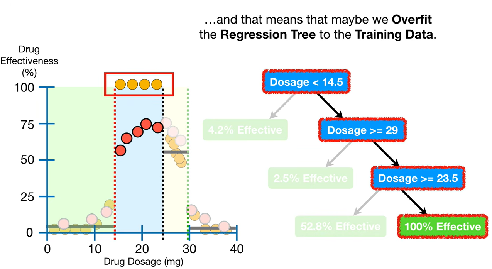

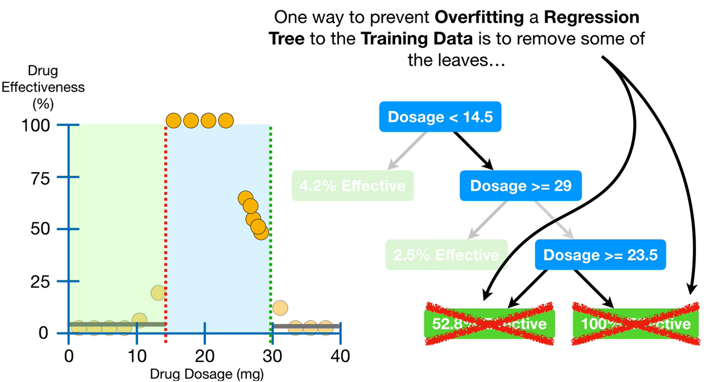

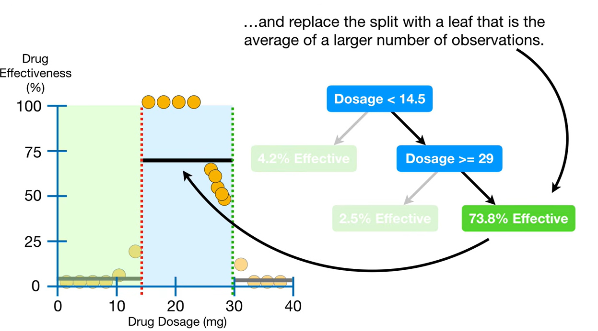

The large residuals tells that the new tree doesnt fit the training data as well as before but the new sub-tree does a much better job with the testing data. 

> The main idea behind pruning a Regression Tree is to prevent overfitting the training data so that the tree will do a better job with the Testing data.

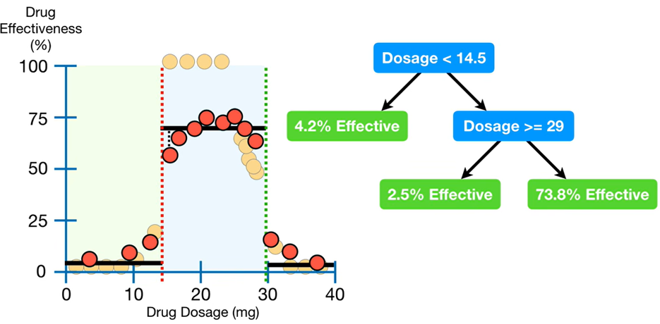

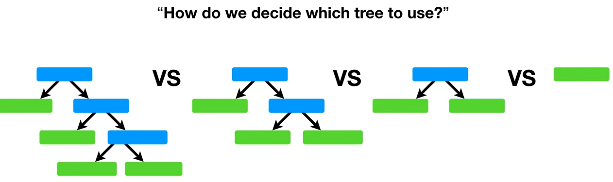
    

**The Process of Cost Complexity Pruning:**

*   **Calculate Sum of Squared Residuals (SSR):** Determine the SSR for the full tree and various pruned subtrees (3:58-7:49).
    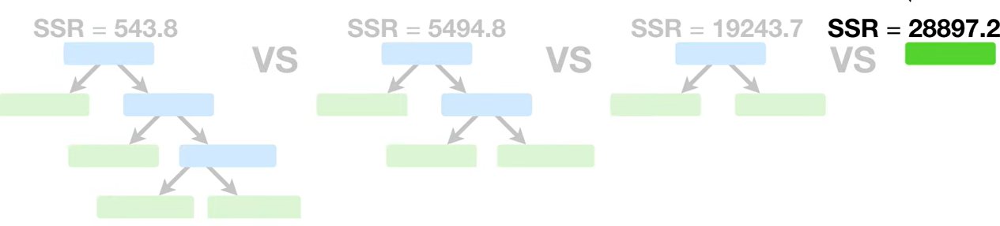
    
    - Observe the SSR is small for the original full-sized tree but each time we remove a leaf, the SSR gets larger and larger. 

    - We knew this was going to happen because the whole idea was for the pruned trees to not fit the training data as well as the full-sized tree. 

*   **Calculate Tree Scores:** Use a tree score formula that balances the **SSR** with a **tree complexity penalty**, which is based on the number of leaves ($T$) and a tuning parameter called **alpha** ($alpha$) (7:50-10:48).
    
      -  Tree-Score = SSR +  $\alpha$T
      - Tree Complexity penalty compensates for the difference in the number of leaves.
      -   $alpha$ is a tuning parameter that we find using cross validation.
  
    For now assume: $\alpha = 10,000$ 

    For the full-sized Tree:   
    $\text{\textbf{Tree Score}} = \mathbf{543.8} + \mathbf{\color{red}10,000} \times \mathbf{4} = 40,543.8$   

    $\text{\textbf{Tree Score}} = \mathbf{5494.8} + \mathbf{\color{red}10,000} \times \mathbf{3} = 35494.8$

    $\text{\textbf{Tree Score}} = \mathbf{19243.7} + \mathbf{\color{red}10,000} \times \mathbf{2} = 39243.7$

    $\text{\textbf{Tree Score}} = \mathbf{28897.2} + \mathbf{\color{red}10,000} \times \boldsymbol{T} = 38897.2$

    So larger the number of leaves, larger the penalty.

    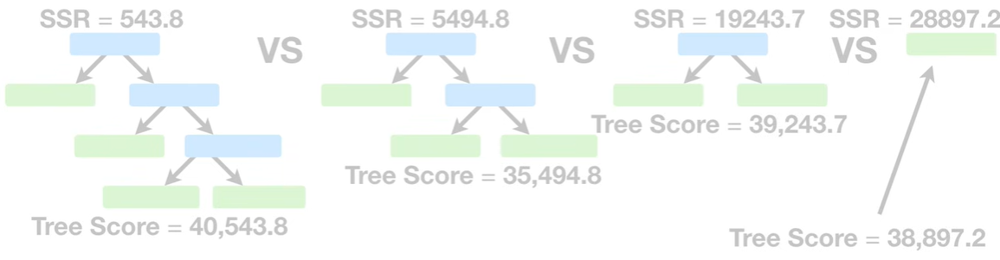

    Now based on this $\alpha = 10,000$ we will choose the 2nd Tree.

    But if $\alpha = 22,000$, we will choose the last tree as then it will have least *Tree score* value.

    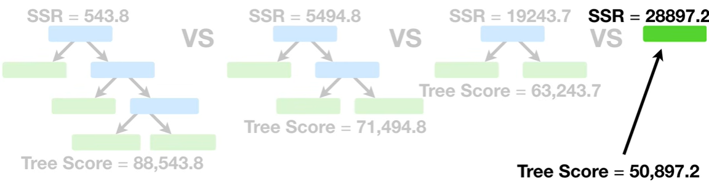

    So we need to find the best value of alpha $\alpha$.

*   **Find the Optimal Alpha:** Use **cross-validation** to test different alpha values and identify the one that results in the lowest average SSR on testing data (11:11-15:27).

    First using all of the data build a full-sized regression tree.

    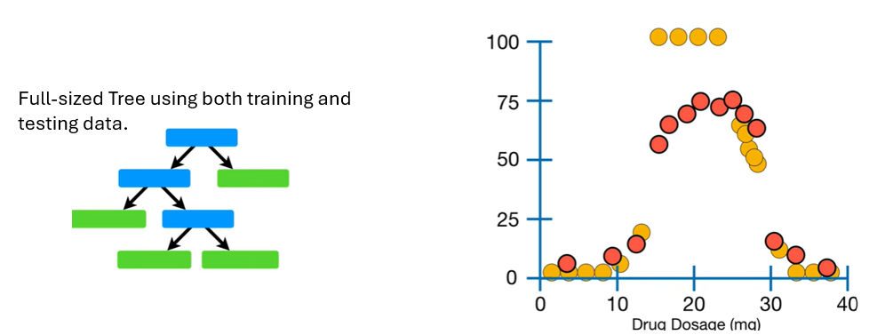
    
    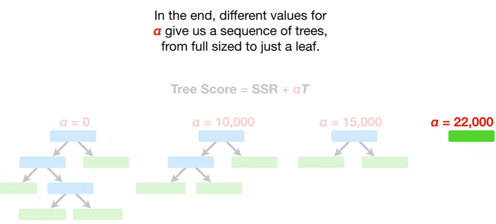

*   **Final Selection:** Choose the original tree and subtree corresponding to the optimal alpha value to create the final, pruned model (15:27-15:47).

## [Decision Trees - Feature Selection and Missing Data ]()